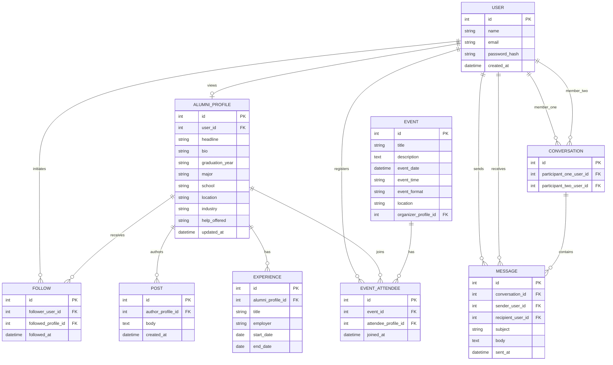

# COMP 3613 Assignment 1

Draft this file with the Guide. **Update it after every phase milestone** before you pause. The use-case diagram is a UML PNG at `docs/diagrams/use-case.png`, linked from this file as `diagrams/use-case.png` (path relative to `docs/report.md`). The model diagram is Mermaid. **Embed wireframe images** as `wireframes/<file>` (files live in `docs/wireframes/`).

Do not put your student ID in this file if you will commit it. The PDF cover adds your name and ID at export time.

## Assigned project
Alumni App

## Named workflows

### 1. View Alumni Profile (User)

### 2. Follow Alumni (Alumni)

### 3. Join event (Alumni)

### 4. Message Alumni (Alumni)

### 5. Make post (Alumni)

## Use case diagram

This draft keeps the actor boundary to the named Phase 1 flows: `User` can view a profile, while `Alumni` can follow, message, join, and post. The shared profile lookup is set as an include for "Follow Alumni" and "Message Alumni" so those flows do not duplicate an actor connection to every use case.

## Model diagram

This model represents the alumni network behind the named flows: a general `User` can view an alumni profile, while `Alumni` records carry follow, message, post, and event participation data. The Phase 4 revision adds the profile details, repeated experience records, and event metadata visible in the wireframes. The same person can act as both a viewer and a profile owner, so profile, follow, and message tables are tied to a shared account record.

Edge-case notes: a follow is modeled as a distinct relation because a user can follow many different alumni, and the same alumni profile can be followed by many users. Messaging is separate from the profile so the sender/recipient relationship can be recorded without collapsing the app into one generic “contact list.” Event participation is modeled as a join table to support multiple attendees per event and multiple events per alumni profile.

## Wireframes

### View Alumni Profile

<!-- student-build:wireframe-coverage
use_case: View Alumni Profile
image: docs/wireframes/View Alumni Profile.png
covered: yes
-->

The profile overview shows identity, alumni details, experience, and mutual connections.

### Follow Alumni

<!-- student-build:wireframe-coverage
use_case: Follow Alumni
image: docs/wireframes/Follow Alumni.png
covered: yes
-->

The profile's Follow action and workflow header cover opening a profile and following. The student clarified that followed alumni's updates appear on the alum's profile and on a shared posting board; the existing `FOLLOW` and `POST` relationships support this outcome.

### Join event

<!-- student-build:wireframe-coverage
use_case: Join event
image: docs/wireframes/Join an event.png
covered: yes
-->

The event listing shows event details, attendance, and a Join event action. The workflow header names a confirmation step, but its outcome/state is not shown.
The student clarified that Join event registers immediately; confirmation is the success state after registration.

### Message Alumni

<!-- student-build:wireframe-coverage
use_case: Message Alumni
image: docs/wireframes/Message an alumni.png
covered: yes
-->

The inbox shows conversation previews, a selected conversation, message history, and a composer with a Send action.

### Make post

<!-- student-build:wireframe-coverage
use_case: Make post
image: docs/wireframes/Make a Post.png
covered: yes
-->

The home feed shows a post composer and a published post. Reaction and comment counts are visible, though no workflows for changing them are named.

## Phase 4 Model Fit Review

The student accepted these wireframe-backed additions:
The student accepted these wireframe-backed additions:

- `ALUMNI_PROFILE.school`, `location`, `industry`, and `help_offered` — visible on View Alumni Profile and Follow Alumni. Existing `graduation_year`, `headline`, and `bio` cover the class year, role summary, and about text.
- `EXPERIENCE.title`, `employer`, `start_date`, and `end_date` — the repeated role/company/date entries on both profile wireframes; each profile can have multiple experience records. "Present" is represented by an open end date.
- `EVENT.event_time` and `EVENT.event_format` — time and the "in person" label on Join an event.
- `CONVERSATION` groups a user's message thread with another user; `MESSAGE.conversation_id` links each message to the thread. Sender and recipient now reference `USER` so messages in either direction can be represented.

The existing `FOLLOW` and `POST` relationships support followed alumni updates on their profile and the shared posting board. Mutual connections and event attendance totals can be derived from existing follow and attendance records. Reaction and comment counts are displayed on Make a Post, but the student confirmed they are not necessary and they are not modeled.

## Theming

Branding: university blue and marine grey, Georgia typography, and a formal, academic tone that remains social. The wordmark is **AlumCircle**.

Applied the brand colors and Georgia font stack through shared CSS tokens. The landing page now presents AlumCircle and its alumni-community purpose; login and registration use the same wordmark and tone. Removed the unused display/body webfont imports and the generic landing-page demo copy and decorations.

Polish: added a UWI St Augustine campus-building photo as the landing background, removed duplicate anonymous sign-in/get-started links from the header, and changed the hero registration action to “Get started.” Signed-in navigation remains available in the header.

Login and registration now share the campus background with a slightly stronger blue overlay for contrast.

## Implementation notes

One named workflow at a time. Include verify notes and polish / model revisions (Phase 5). Do not treat the first build as final.

### View Alumni Profile

Implemented the searchable alumni directory at `/profiles` and profile details at `/profiles/{profile_id}`. The profile view shows the account name, alumni details, and experience entries. Registration collects `User.name` to match the ERD. `python manage.py init` seeds Maya Chen's wireframe profile and experience history.

Polish: the sidebar is fixed with its own scroll area; the profile back link and top navbar are removed on the detail view; the banner starts the page and contains the sidebar toggle. Added an Education section that displays the exact degree from the existing `major` field alongside school and graduation year; an unset degree shows “Not provided.” Student reviewed the profile and requested these final layout/education refinements before moving on.

<!-- student-build:code-check
workflow: View Alumni Profile
snippet: AlumniProfile account FK and profile fields in app/models/user.py
passed: yes
architecture_ok: yes
-->

<!-- student-build:code-check
workflow: View Alumni Profile
snippet: UserService delegates alumni-profile lookup to UserRepository in app/services/user_service.py
passed: yes
architecture_ok: yes
-->

<!-- student-build:code-check
workflow: View Alumni Profile
snippet: view_alumni_profile service call and response in app/routers/users.py
passed: yes
architecture_ok: yes
note: TemplateResponse follows the workspace runtime signature.
-->

<!-- student-build:code-check
workflow: View Alumni Profile
snippet: UserRepository profile lookup by primary key in app/repositories/user.py
passed: yes
architecture_ok: yes
-->

### Follow Alumni

Interaction decision: after following, the button shows “Following”; on hover it shows “Unfollow,” and clicking removes the follow.

<!-- student-build:code-check
workflow: Follow Alumni
snippet: Follow table with account/profile foreign keys, timestamp, and duplicate-pair constraint in app/models/user.py
passed: yes
architecture_ok: yes
-->

<!-- student-build:code-check
workflow: Follow Alumni
snippet: toggle_alumni_follow service call and redirect in app/routers/users.py
passed: yes
architecture_ok: yes
-->

Implemented the Follow toggle through repository and service layers. The profile button shows “Following” after activation and changes to “Unfollow” on hover; submitting it removes the follow. An isolated SQLite check confirmed the state transitions. Student confirmed the local Follow workflow works.

### Join event

Interaction decision: attendees can withdraw from an event. The Events page will include separate sections for upcoming events and events the signed-in user has joined.

Eligibility decision: only signed-in users with an `AlumniProfile` may join or withdraw; attendance records link to that profile.

<!-- student-build:code-check
workflow: Join event
snippet: Event and EventAttendee SQLModel definitions in app/models/user.py
passed: yes
architecture_ok: yes
note: both AlumniProfile foreign keys resolve to `alumni_profile.id`; the attendance pair is unique.
-->

<!-- student-build:code-check
workflow: Join event
snippet: toggle_event_attendance service call and redirect in app/routers/events.py
passed: yes
architecture_ok: yes
note: redirect resolves to the registered `events_view` endpoint.
-->

Implemented `/events` with **My events** above Upcoming events. Only users with an `AlumniProfile` can join or withdraw; event attendance is stored against that profile. Withdrawing returns the event to Upcoming. `python manage.py init` seeds two sample campus events. An isolated repository check confirmed the alumni-only gate and join/withdraw transitions. Student confirmed the local workflow works.

### Message Alumni

The flow starts from an alum's profile, then composes the first message and continues in the inbox conversation. The inbox pencil is the new-message entry point.

<!-- student-build:code-check
workflow: Message Alumni
snippet: Conversation participants and Message foreign keys/content fields in app/models/user.py
passed: yes
architecture_ok: yes
note: runtime inspection confirms all conversation, sender, and recipient foreign keys resolve.
-->

<!-- student-build:code-check
workflow: Message Alumni
snippet: send_message service call and redirect in app/routers/messages.py
passed: yes
architecture_ok: yes
note: calls `send_to_profile` and redirects to `messages_view` with the returned conversation ID.
-->

Implemented profile compose, the inbox pencil recipient picker, conversation threads, and replies. New messages reuse a conversation between the same two users; only participants can reply. An isolated repository check confirmed conversation reuse, inbox/thread retrieval, replies, and participant enforcement. Student confirmed the local workflow works.

### Make post

Feed scope decision: Home shows the signed-in user's own posts and posts from alumni they follow. Reaction and comment counts remain display-only; no reaction or comment workflows are modeled.

<!-- student-build:code-check
workflow: Make post
snippet: Post author profile FK, body, and creation timestamp in app/models/user.py
passed: yes
architecture_ok: yes
note: runtime inspection confirms author_profile_id references alumni_profile.id.
-->

<!-- student-build:code-check
workflow: Make post
snippet: create_post service call and redirect in app/routers/user_home.py
passed: yes
architecture_ok: yes
note: calls `create_for_user` and redirects to the registered Home route.
-->

Implemented the Home composer and feed. Posts are ordered newest first and include the user's own alumni profile and followed alumni. Publishing requires an alumni profile; reactions and comments remain unmodeled. An isolated repository check confirmed follow-feed visibility and the alumni-only publish rule. Student confirmed the local workflow works.

Supporting functionality (not a named workflow): signed-in users can complete or edit their alumni profile at `/profile/complete`. School, graduation year, and degree are required; professional details are optional. The Home prompt and **My Profile** navigation link provide entry points. Runtime checks confirmed create, update, and required-field validation; no additional workflow code-check was required.

## Deployed app

Phase 6. Public Render URL (not localhost). Markers open this to mark the three workflows.

https://

## Logins

Every account a marker needs, including extra users you added. Starter accounts:

- bob / bobpass — regular user
- admin / adminpass — admin
- maya / mayapass — regular user with the wireframe alumni profile

## YouTube URL

## Session transcripts

Filled when the Guide builds the report: the agent writes each Guide chat to `docs/transcripts/<slug>.md` (Copilot Agent, Cursor, or OpenCode). `python manage.py report` packages them. Do not paste chats here during the build.

## Competency (student-judge)

Filled when the report is built. Guide runs student-judge, writes `docs/judge.md`, and export appends the scorecard here.

## Skill integrity

Filled by `python manage.py report`. Do not edit the course skills.
