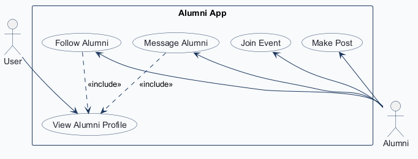
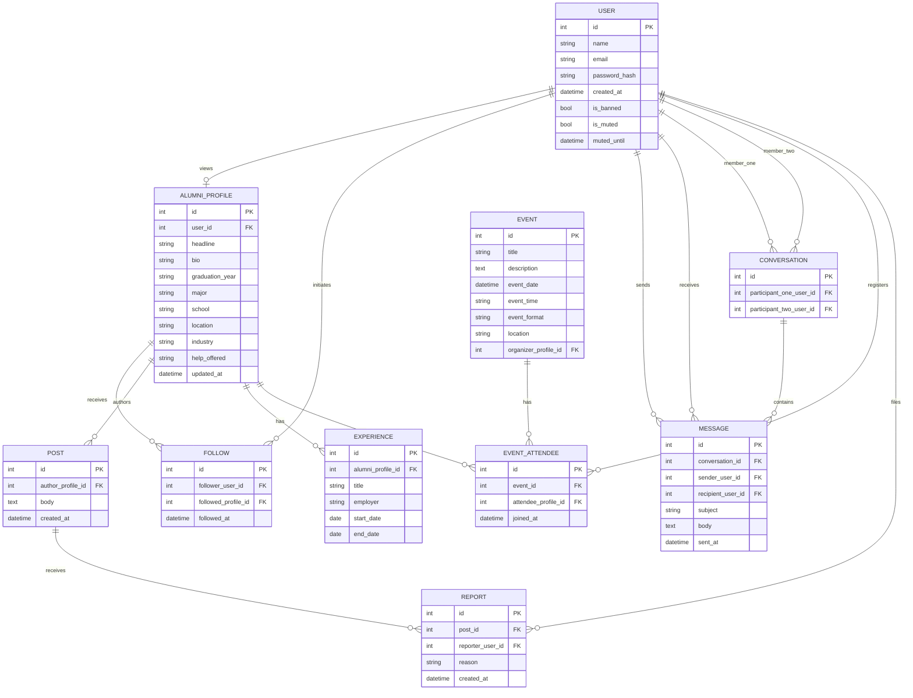
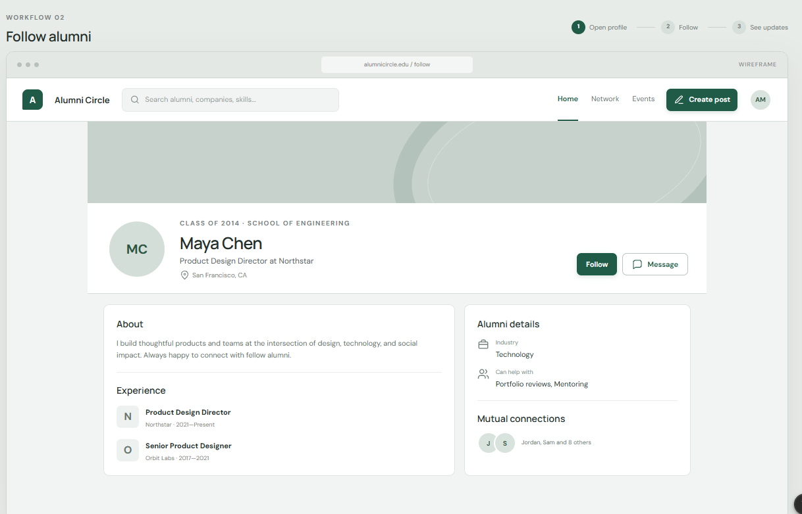
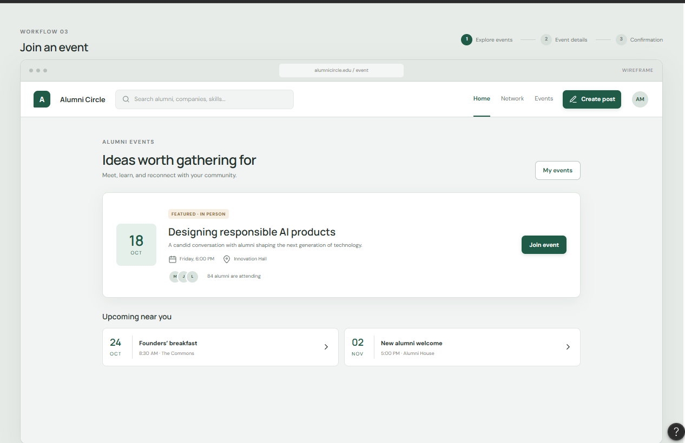
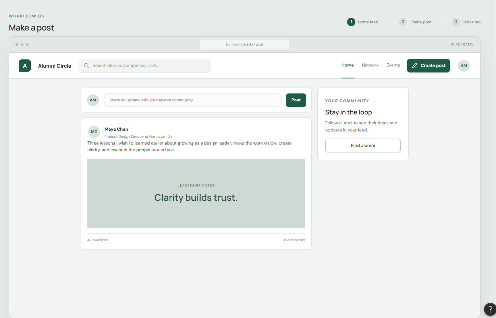
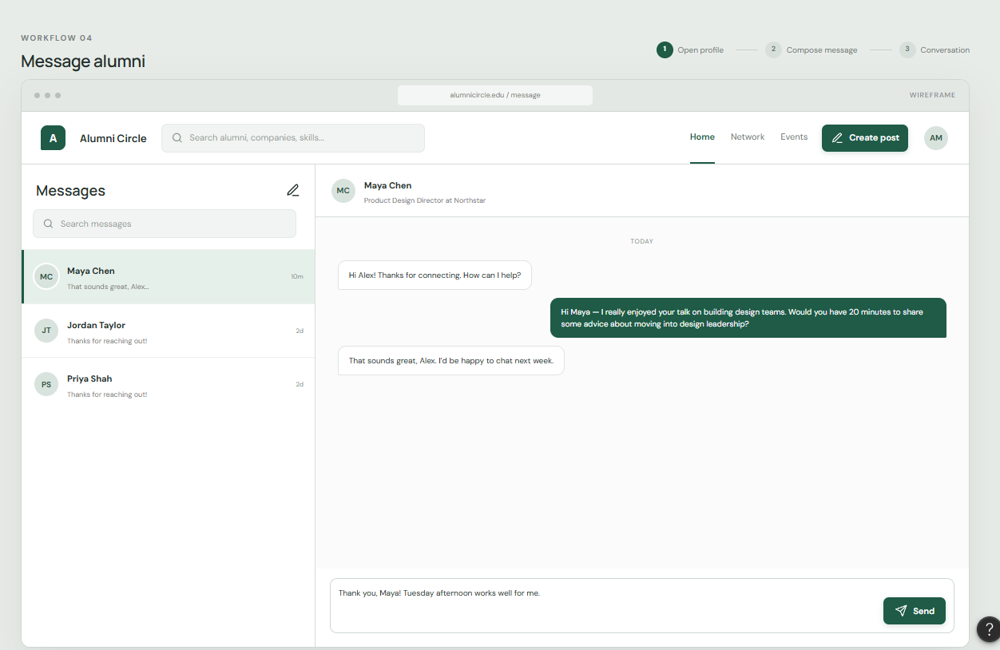
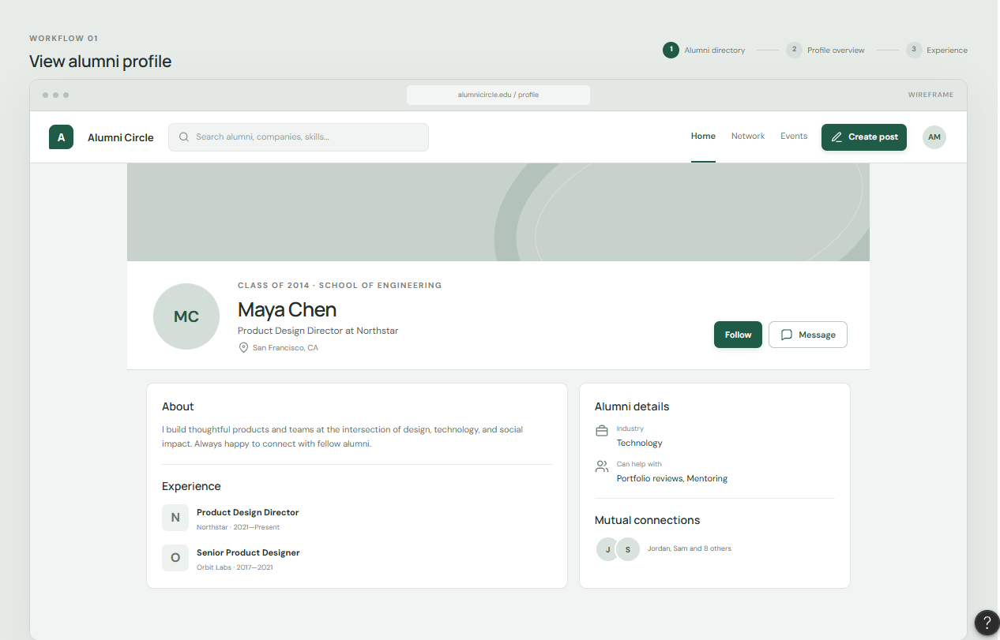

<!-- student-build:skill-integrity
status: pass
root: e84cd692d0b85eefe546385661958c27d07e8be6c5176a82012f68ccff5c8beb
expected_root: e84cd692d0b85eefe546385661958c27d07e8be6c5176a82012f68ccff5c8beb
mismatches: none
-->

# COMP 3613 Assignment 1

Draft this file with the Guide. **Update it after every phase milestone** before you pause. The use-case diagram is a UML PNG at `docs/diagrams/use-case.png`, linked from this file as `diagrams/use-case.png` (path relative to `docs/report.md`). The model diagram is Mermaid. **Embed wireframe images** as `wireframes/<file>` (files live in `docs/wireframes/`).

Do not put your student ID in this file if you will commit it. The PDF cover adds your name and ID at export time.

## Assigned project
Alumni App

## Named workflows

### 1. View Alumni Profile (User)

### 2. Follow Alumni (Alumni)

### 3. Join event (Alumni)

### 4. Message Alumni (Alumni)

### 5. Make post (Alumni)

## Use case diagram

This draft keeps the actor boundary to the named Phase 1 flows: `User` can view a profile, while `Alumni` can follow, message, join, and post. The shared profile lookup is set as an include for "Follow Alumni" and "Message Alumni" so those flows do not duplicate an actor connection to every use case.

## Model diagram

This model represents the alumni network behind the named flows: a general `User` can view an alumni profile, while `Alumni` records carry follow, message, post, and event participation data. The Phase 4 revision adds the profile details, repeated experience records, and event metadata visible in the wireframes. The same person can act as both a viewer and a profile owner, so profile, follow, and message tables are tied to a shared account record. A later Phase 5 addition (content moderation) adds the `is_banned` / `is_muted` / `muted_until` flags on `USER` and a `REPORT` table so users can flag posts and the admin account can review, remove, dismiss, ban, or mute.

Edge-case notes: a follow is modeled as a distinct relation because a user can follow many different alumni, and the same alumni profile can be followed by many users. Messaging is separate from the profile so the sender/recipient relationship can be recorded without collapsing the app into one generic “contact list.” Event participation is modeled as a join table to support multiple attendees per event and multiple events per alumni profile. `REPORT` is a distinct relation with a `(post_id, reporter_user_id)` unique constraint so one person cannot flag the same post twice; its optional `reason` supports the optional-reason report flow. `muted_until` is `NULL` for an indefinite mute and holds an expiry timestamp for a timed mute.

## Wireframes

### View Alumni Profile

<!-- student-build:wireframe-coverage
use_case: View Alumni Profile
image: docs/wireframes/View Alumni Profile.png
covered: yes
-->

The profile overview shows identity, alumni details, experience, and mutual connections.

### Follow Alumni

<!-- student-build:wireframe-coverage
use_case: Follow Alumni
image: docs/wireframes/Follow Alumni.png
covered: yes
-->

The profile's Follow action and workflow header cover opening a profile and following. The student clarified that followed alumni's updates appear on the alum's profile and on a shared posting board; the existing `FOLLOW` and `POST` relationships support this outcome.

### Join event

<!-- student-build:wireframe-coverage
use_case: Join event
image: docs/wireframes/Join an event.png
covered: yes
-->

The event listing shows event details, attendance, and a Join event action. The workflow header names a confirmation step, but its outcome/state is not shown.
The student clarified that Join event registers immediately; confirmation is the success state after registration.

### Message Alumni

<!-- student-build:wireframe-coverage
use_case: Message Alumni
image: docs/wireframes/Message an alumni.png
covered: yes
-->

The inbox shows conversation previews, a selected conversation, message history, and a composer with a Send action.

### Make post

<!-- student-build:wireframe-coverage
use_case: Make post
image: docs/wireframes/Make a Post.png
covered: yes
-->

The home feed shows a post composer and a published post. Reaction and comment counts are visible, though no workflows for changing them are named.

### Follow Alumni

### Join an event

### Make a Post

### Message an alumni

### View Alumni Profile

## Phase 4 Model Fit Review

The student accepted these wireframe-backed additions:
The student accepted these wireframe-backed additions:

- `ALUMNI_PROFILE.school`, `location`, `industry`, and `help_offered` — visible on View Alumni Profile and Follow Alumni. Existing `graduation_year`, `headline`, and `bio` cover the class year, role summary, and about text.
- `EXPERIENCE.title`, `employer`, `start_date`, and `end_date` — the repeated role/company/date entries on both profile wireframes; each profile can have multiple experience records. "Present" is represented by an open end date.
- `EVENT.event_time` and `EVENT.event_format` — time and the "in person" label on Join an event.
- `CONVERSATION` groups a user's message thread with another user; `MESSAGE.conversation_id` links each message to the thread. Sender and recipient now reference `USER` so messages in either direction can be represented.

The existing `FOLLOW` and `POST` relationships support followed alumni updates on their profile and the shared posting board. Mutual connections and event attendance totals can be derived from existing follow and attendance records. Reaction and comment counts are displayed on Make a Post, but the student confirmed they are not necessary and they are not modeled.

## Theming

Branding: university blue and marine grey, Georgia typography, and a formal, academic tone that remains social. The wordmark is **AlumCircle**.

Applied the brand colors and Georgia font stack through shared CSS tokens. The landing page now presents AlumCircle and its alumni-community purpose; login and registration use the same wordmark and tone. Removed the unused display/body webfont imports and the generic landing-page demo copy and decorations.

Polish: added a UWI St Augustine campus-building photo as the landing background, removed duplicate anonymous sign-in/get-started links from the header, and changed the hero registration action to “Get started.” Signed-in navigation remains available in the header.

Login and registration now share the campus background with a slightly stronger blue overlay for contrast.

## Implementation notes

One named workflow at a time. Include verify notes and polish / model revisions (Phase 5). Do not treat the first build as final.

### View Alumni Profile

Implemented the searchable alumni directory at `/profiles` and profile details at `/profiles/{profile_id}`. The profile view shows the account name, alumni details, and experience entries. Registration collects `User.name` to match the ERD. `python manage.py init` seeds Maya Chen's wireframe profile and experience history.

Polish: the sidebar is fixed with its own scroll area; the profile back link and top navbar are removed on the detail view; the banner starts the page and contains the sidebar toggle. Added an Education section that displays the exact degree from the existing `major` field alongside school and graduation year; an unset degree shows “Not provided.” Student reviewed the profile and requested these final layout/education refinements before moving on.

<!-- student-build:code-check
workflow: View Alumni Profile
snippet: AlumniProfile account FK and profile fields in app/models/user.py
passed: yes
architecture_ok: yes
-->

<!-- student-build:code-check
workflow: View Alumni Profile
snippet: UserService delegates alumni-profile lookup to UserRepository in app/services/user_service.py
passed: yes
architecture_ok: yes
-->

<!-- student-build:code-check
workflow: View Alumni Profile
snippet: view_alumni_profile service call and response in app/routers/users.py
passed: yes
architecture_ok: yes
note: TemplateResponse follows the workspace runtime signature.
-->

<!-- student-build:code-check
workflow: View Alumni Profile
snippet: UserRepository profile lookup by primary key in app/repositories/user.py
passed: yes
architecture_ok: yes
-->

### Follow Alumni

Interaction decision: after following, the button shows “Following”; on hover it shows “Unfollow,” and clicking removes the follow.

<!-- student-build:code-check
workflow: Follow Alumni
snippet: Follow table with account/profile foreign keys, timestamp, and duplicate-pair constraint in app/models/user.py
passed: yes
architecture_ok: yes
-->

<!-- student-build:code-check
workflow: Follow Alumni
snippet: toggle_alumni_follow service call and redirect in app/routers/users.py
passed: yes
architecture_ok: yes
-->

Implemented the Follow toggle through repository and service layers. The profile button shows “Following” after activation and changes to “Unfollow” on hover; submitting it removes the follow. An isolated SQLite check confirmed the state transitions. Student confirmed the local Follow workflow works.

### Join event

Interaction decision: attendees can withdraw from an event. The Events page will include separate sections for upcoming events and events the signed-in user has joined.

Eligibility decision: only signed-in users with an `AlumniProfile` may join or withdraw; attendance records link to that profile.

<!-- student-build:code-check
workflow: Join event
snippet: Event and EventAttendee SQLModel definitions in app/models/user.py
passed: yes
architecture_ok: yes
note: both AlumniProfile foreign keys resolve to `alumni_profile.id`; the attendance pair is unique.
-->

<!-- student-build:code-check
workflow: Join event
snippet: toggle_event_attendance service call and redirect in app/routers/events.py
passed: yes
architecture_ok: yes
note: redirect resolves to the registered `events_view` endpoint.
-->

Implemented `/events` with **My events** above Upcoming events. Only users with an `AlumniProfile` can join or withdraw; event attendance is stored against that profile. Withdrawing returns the event to Upcoming. `python manage.py init` seeds two sample campus events. An isolated repository check confirmed the alumni-only gate and join/withdraw transitions. Student confirmed the local workflow works.

### Message Alumni

The flow starts from an alum's profile, then composes the first message and continues in the inbox conversation. The inbox pencil is the new-message entry point.

<!-- student-build:code-check
workflow: Message Alumni
snippet: Conversation participants and Message foreign keys/content fields in app/models/user.py
passed: yes
architecture_ok: yes
note: runtime inspection confirms all conversation, sender, and recipient foreign keys resolve.
-->

<!-- student-build:code-check
workflow: Message Alumni
snippet: send_message service call and redirect in app/routers/messages.py
passed: yes
architecture_ok: yes
note: calls `send_to_profile` and redirects to `messages_view` with the returned conversation ID.
-->

Implemented profile compose, the inbox pencil recipient picker, conversation threads, and replies. New messages reuse a conversation between the same two users; only participants can reply. An isolated repository check confirmed conversation reuse, inbox/thread retrieval, replies, and participant enforcement. Student confirmed the local workflow works.

### Make post

Feed scope decision: Home shows the signed-in user's own posts and posts from alumni they follow. Reaction and comment counts remain display-only; no reaction or comment workflows are modeled.

<!-- student-build:code-check
workflow: Make post
snippet: Post author profile FK, body, and creation timestamp in app/models/user.py
passed: yes
architecture_ok: yes
note: runtime inspection confirms author_profile_id references alumni_profile.id.
-->

<!-- student-build:code-check
workflow: Make post
snippet: create_post service call and redirect in app/routers/user_home.py
passed: yes
architecture_ok: yes
note: calls `create_for_user` and redirects to the registered Home route.
-->

Implemented the Home composer and feed. Posts are ordered newest first and include the user's own alumni profile and followed alumni. Publishing requires an alumni profile; reactions and comments remain unmodeled. An isolated repository check confirmed follow-feed visibility and the alumni-only publish rule. Student confirmed the local workflow works.

Supporting functionality (not a named workflow): signed-in users can complete or edit their alumni profile at `/profile/complete`. School, graduation year, and degree are required; professional details are optional. The Home prompt and **My Profile** navigation link provide entry points. Runtime checks confirmed create, update, and required-field validation; no additional workflow code-check was required.

### Content moderation (admin) — supporting functionality, not a named workflow

Sign in with `admin` / `adminpass` to land on `/admin`; no other account has these powers, and every moderation route is gated by the admin-only dependency.

- **Report a post:** any signed-in non-author can flag a feed post with an optional reason (`POST /posts/{id}/report`). The `(post_id, reporter_user_id)` unique constraint blocks duplicate reports, and self-reports are refused in `ModerationService.report_post`.
- **Reported-posts queue:** `/admin` lists each report with the post, author, reporter, reason, and timestamp. The admin can **remove the post** (also clears its reports), **dismiss the report**, or **ban the author**; all three confirm first via the shared `data-confirm` dialog.
- **Member table:** `/admin` lists every member with an Active / Muted / Banned status badge plus **Ban/Unban** and a **Mute** duration (1h, 24h, 7d, 30d, indefinite) or **Unmute**. Admins cannot ban, mute, or moderate themselves or other admin accounts.
- **Ban** refuses login with a clear message, and `get_current_user` rejects banned cookies so an existing session dies immediately. **Mute** allows browsing but blocks posting, following, joining events, messaging, and reporting; timed mutes expire automatically (`muted_until`) while indefinite mutes need an explicit unmute. A muted user sees a banner instead of the Home composer and the report control.
- **Registration hardening:** `AuthService.register_user` explicitly rejects taken usernames/emails (case-insensitive) before insert; the `unique=True` constraints remain the database backstop.
- **Schema:** additive `ALTER TABLE "user" ADD COLUMN` migration in `app/database.py` plus a new `report` table, so existing local and Render databases keep their data. Rules live in `ModerationService`, SQL in `ModerationRepository`, and routes stay thin (service call + flash + redirect).

## Deployed app

Phase 6. Public Render URL (not localhost). Markers open this to mark the three workflows.

[Deployed App](https://three613a1.onrender.com/)

## Logins

Every account a marker needs, including extra users you added. Starter accounts:

- bob / bobpass — regular user
- admin / adminpass — admin
- maya / mayapass — regular user with the wireframe alumni profile

## YouTube URL

- https://youtu.be/HLCcRh7A7T0

## Session transcripts

Filled when the Guide builds the report: the agent writes chat markdown into `docs/transcripts/`; `python manage.py report` packages them.

Guide packaged **7** chat(s) in `docs/transcripts/` (and `docs/transcripts.zip`).

Index: [docs/transcripts/INDEX.md](transcripts/INDEX.md)

- [`opencode-phase5-moderation-and-final-report`](transcripts/opencode-phase5-moderation-and-final-report.md)
- [`opencode-phase5-polish-and-report`](transcripts/opencode-phase5-polish-and-report.md)
- [`phase-1-project-and-workflows`](transcripts/phase-1-project-and-workflows.md)
- [`phase-2-use-case-diagram`](transcripts/phase-2-use-case-diagram.md)
- [`phase-3-model-diagram`](transcripts/phase-3-model-diagram.md)
- [`phase-4-wireframes`](transcripts/phase-4-wireframes.md)
- [`phase-5-theming-build-polish`](transcripts/phase-5-theming-build-polish.md)

## Competency (student-judge)

Filled by Guide from the student-judge run when this report was built.

**Judged at:** 2026-10-13T00:43Z
**Evidence pass:** re-read native chats + current docs/report.md (prior judge.md ignored)

**Student / session:** Delano Augustus (816037685) — AlumCircle, COMP 3613 Assignment 1
**Artifact:** 7 Guide chats in `docs/transcripts/` (5 Copilot phase chats + 2 OpenCode sessions pulled from the OpenCode session store) and current `docs/report.md`
**Phases in evidence:** 1–6 (COMP 3613; Phase 5 polish, Phase 6 deploy; never generic 0–5)

### Totals
| | Count / value |
|--|--|
| Metrics on rubric | 12 (M1–M12) |
| N/A (excluded) | 0 |
| Metrics scored | 12 |
| Scoreable max | 48 |
| Awarded total | 46 / 48 |
| **Overall (avg of scored)** | **3.8 / 4** |
| Impression mark | 17 / 20 |

## Scorecard

| ID | Metric | Score / 4 | In avg | Evidence |
|----|--------|----------:|:------:|----------|
| M1 | Phase discipline | 4 | yes | One phase per chat; student enforced handoffs — *"you have to give the next phase prompt at the end of every phase"*, *"what is the phase 4 prompt"*; deploy gated on polish approval — *"do not push to github when done instead run a local instance of the app on my browser for me to confirm if i think its good"* → later *"good job you can push this version to github"*. The Oct 12 moderation feature stayed inside the Phase 5 chat as the framework allows. |
| M2 | Problem framing | 3 | yes | Project *"Alumni app"* + five `Feature (user)` lines + theming in own words (*"Colors: university blue and marine grey / Type: Georgia…"*); requirements in own words at bonus-feature time (*"no othr user should have that functionality and there should never be duplicate usernames or emails allowed on the site"*). Capped at 3 because include/extend Q&A and a student-typed entity list never appear — Guide asked **0/4** (P2) and **0/5** (P3) questions, so that evidence was never elicited (Guide miss, not a refusal). |
| M3 | Decision ownership | 3 | yes | Owned wireframes, project, workflows, theming, and model revisions — *"1, 2 and 3"*, *"implement conversation grouping and yes reation and comment count arent necessary"*, *"only alumni should be able to join events, to stick to the sites identity its just a placve for alumni of a school to interact"*. Capped at 3 for the same reason as M2: entity/relationship definition in Phases 2–3 was never put to the student, so that slice of ownership is unproven rather than refused. |
| M4 | Artefact-before-code | 4 | yes | ERD and wireframes treated as the spec — student insisted the ERD render (*"fix the ERD it doesnt show in the markdown preview"*), Phase 4 model-fit drove accepted ERD edits, and the bonus moderation feature updated the ERD (`REPORT` entity + USER moderation fields) with its implementation note **before/with** the code, not after. |
| M5 | Verification habit | 4 | yes | Per-workflow verify reports throughout — *"after signin i get a server erro message"*, *"error 310 on events page, check for wat might be causing this erro every time you create a new page"*, polish feedback (*"the webpage content is still a bit removed from the sidebar…"*), deploy check (*"hard refresh fixed it"*), and for the moderation feature *"its not up"* (reported the dead dev server) then *"it works you can push the update"*. Never accepted a first dump. |
| M6 | Assignment fit | 4 | yes | Layered architecture shipped and re-verified at commit `f03e5d4`: the only `select`/`db.exec` added in the whole moderation diff lives in `app/repositories/user.py`; every route stays service-call → flash → 303. Wireframe-first, starter auth reused, polish before deploy. |
| M7 | Slice explanation | 4 | yes | Own-words scope reasoning — *"im pretty sure code snippets are only for named workflows which have already been detailed and code snippets done for my named workflows in the report"* (correct architecture/scope rule, and Guide agreed). Student completed the SQLModel + thin-route snippet pairs with correction loops; 14 `student-build:code-check` blocks in `docs/report.md` carry `architecture_ok: yes`. |
| M8 | Prompt quality | 4 | yes | Phase-tagged openers verbatim (*"Use the student-build skill. Phase 4. Here are my wireframe images…"*); concrete contextual mismatch notes — *"remove school from the seach examples the app is for inter school faculty events so that doesnt track with the apps identity, do that then let me know when to check"*. |
| M9 | Response to pushback | 4 | yes | Accepted every failed check and fixed it (rename `created_at`→`followed_at`; FK `alumniprofile.id`→`alumni_profile.id`; route-name and service-name corrections), then kept steering polish in rounds — *"please re instate the landing page background image from before, same colored overlay and everything, everything else is fine"*, *"the boxes with page content should span from sidebar until the end of the page"*. |
| M10 | Integrity | 4 | yes | No paste dumps, no assistant-voice turns, no suspicion rounds; `python manage.py skills-verify` → **pass** (root matches lock); `.agents/skills/`, `.cursor/skills/`, `AGENTS.md` untouched by every diff in the record. |
| M11 | Provenance continuity | 4 | yes | Every built slice traces to this project's own artefacts (5 wireframes, ERD, named workflows); the bonus moderation feature extends the same ERD and repo/service/router patterns rather than a parallel design. |
| M12 | Sincerity trajectory | 4 | yes | No `student-judge:sincerity` block exists in any chat — suspicion was never raised; engagement ran clean from Phase 1 to the final export request. |

## Strengths
- Verification loop is the strongest evidence in the record: real error reports (500, error 310 ×3), layout mismatch notes in plain language, a deploy-side cache diagnosis confirmed by *"hard refresh fixed it"*, and a per-feature sign-off (*"it works you can push the update"*) before any push.
- Architecture holds end-to-end, re-verified fresh this run: SQL only in repositories; rules only in services (including the new `ModerationService` and the self-follow rule); thin routes.
- Snippet ladder actually ran: 14 `student-build:code-check` blocks with `architecture_ok: yes`, including failed-then-corrected attempts — genuine learning, not rubber-stamping.
- Student policed the process itself (phase handoff prompts, snippet-scope correction that Guide confirmed, push/verify gating).
- Two-agent continuity (Copilot phases 1–5 → OpenCode polish/deploy/moderation) with the same artefacts carried forward.

## Gaps (priority order)
1. None material after this fresh evidence pass. (Include/extend Q&A and a student-typed entity list are absent because Guide asked 0 questions in Phases 2–3 — a Guide miss under the opportunity rule, scored in M2/M3, not listed as a student Gap. The previously outstanding submission items — empty YouTube section, unpushed polish, stale PDF — are now fixed: video link added, `f03e5d4` pushed and deployed, fresh package exported.)

## Phase gate status
| Phase | Status | Note |
|-------|--------|------|
| 1 | met | Alumni App + five `Feature (user)` lines; missing `(user)` on Follow caught and restated by the student. |
| 2 | met | UML PNG generated (`python manage.py usecase`), embedded; Guide asked 0 questions (noted above). |
| 3 | met | Mermaid `erDiagram` in the report; relationship/edge-case notes present (Guide drafted without eliciting entities). |
| 4 | met | 5 wireframes embedded with 5 coverage blocks; workflow clarifications answered ("it registers immediately"; follow updates on profile + shared board); model revisions accepted and applied. |
| 5 | met | Theme applied (later re-themed to Rubik/eggshell on student steering), all five workflows built with snippets, then **three-plus polish rounds** (15-point fix list, layout iterations, moderation feature with verify note) — first-dump red flag does not apply. |
| 6 | met | Public Render URL verified live at judge time (HTTP 200 after cold start); marker logins + video link in `docs/report.md`. |

## Recommended next practice
- Weakest scored metrics are M2/M3 (3). Exercise: give a 5-minute spoken or written walkthrough of your own `erDiagram` — why `FOLLOW` and `EVENT_ATTENDEE` are bridge tables, which entity holds each foreign key, and what breaks if a relationship is flipped. Articulating model decisions in your own words is the one skill the record could not evidence (because it was never asked), and it is exactly what a live marker defense tests.

## Integrity note
- **Clean** — no answer-seeking, no external-LLM paste-back, skills unedited (`skills-verify` pass at judge time).
## Provenance flags
- None
## Sincerity log summary
- Blocks found: 0 | max round: 0 | min/mean/final confidence: n/a | trend: n/a | cleared: n/a (suspicion never raised)
## Skips
- Skips: 0/3 used — none skipped in any chat. The Oct 12 snippet request was a scope correction the Guide agreed with (*"No skips used; that was a scope correction, not a skip"*), not a skip.

## Skill integrity

Course skills are hashed at export and compared to `.agents/skills.lock.json`. Do not edit `.agents/skills/`, `.cursor/skills/`, or `AGENTS.md`.

- Status: **pass**
- Root: `e84cd692d0b85eefe546385661958c27d07e8be6c5176a82012f68ccff5c8beb`
- none
## Skill integrity

Course skills are hashed at export and compared to `.agents/skills.lock.json`. Do not edit `.agents/skills/`, `.cursor/skills/`, or `AGENTS.md`.

- Status: **pass**
- Root: `e84cd692d0b85eefe546385661958c27d07e8be6c5176a82012f68ccff5c8beb`
- none
